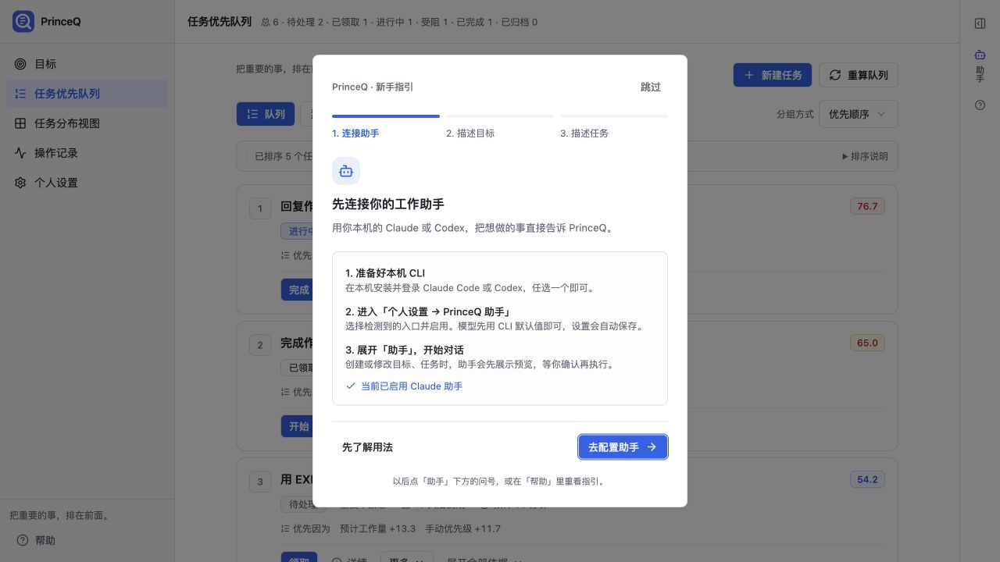
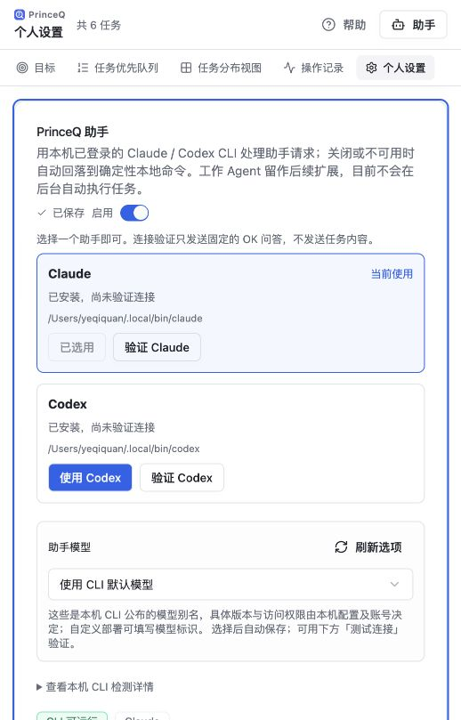
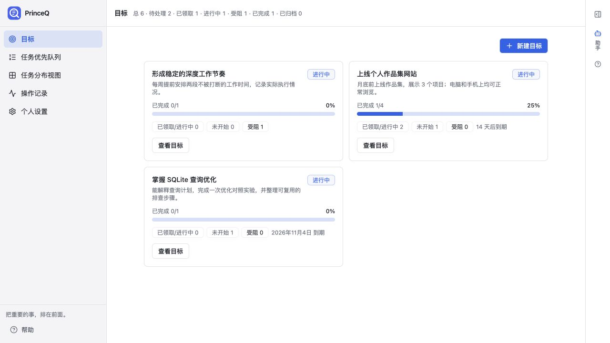
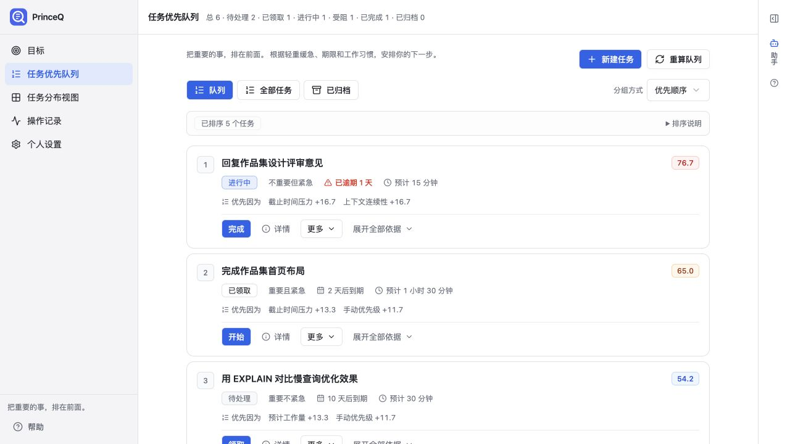
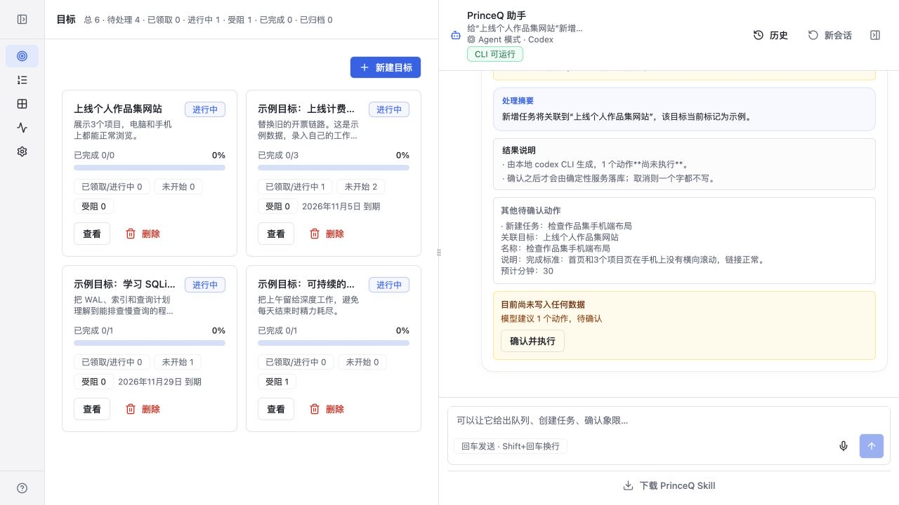
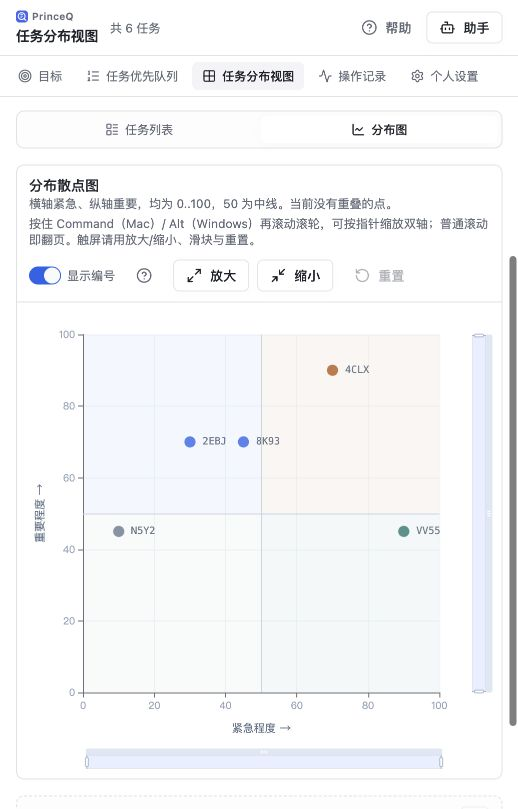
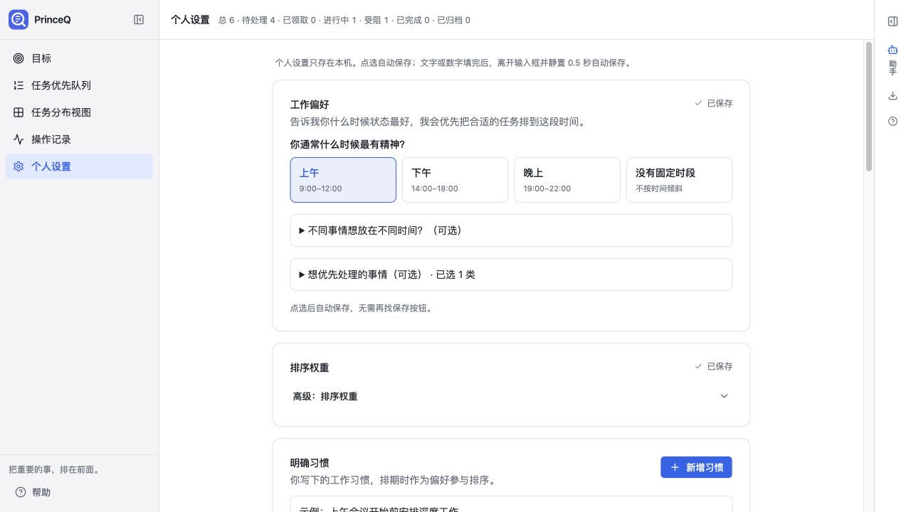

# PrinceQ

把重要的事，排在前面。

PrinceQ 是本地优先的个人工作队列，帮助你安排任务与目标，并用 Claude / Codex 助手处理请求。

## 快速启动

需要 Git 和 **Node.js 24 LTS（含 npm）**。当前服务直接运行 TypeScript，并使用 Node 内置 SQLite，请先用 `node --version` 确认版本为 `v24.x`。使用外部 Agent Skill 客户端时还需要 Python 3。

如果已安装 nvm，可以先切换 Node 版本：

```sh
nvm install 24
nvm use 24
```

### 首次安装并启动

```sh
git clone https://github.com/quanqqqqq/PrinceQ.git
cd PrinceQ
npm ci
npm run db:setup
npm run dev
```

启动后打开 **[http://127.0.0.1:28641](http://127.0.0.1:28641)**。

`npm run dev` 会同时启动两个服务：前端监听 `127.0.0.1:28641`，Node API 监听 `127.0.0.1:28642`；前端的 `/api` 请求会自动转发给 API。保持终端运行，按 `Ctrl+C` 停止服务。

`db:setup` 会创建数据库、默认个人设置，并在全新数据库中放入示例任务；已有数据不会重复播种。首次安装后，日常启动无需重复安装依赖或初始化数据库。

### 日常启动

在克隆的 `PrinceQ` 目录中，确认使用 Node 24 后运行：

```sh
npm run dev
```

也可以分别在两个终端中运行 `npm run dev:api` 和 `npm run dev:web`，便于单独查看后端、前端日志。

### 后台运行（macOS / Linux）

如果希望关闭终端后继续运行，在 `PrinceQ` 目录中执行以下命令。前台服务已运行时，先按 `Ctrl+C` 停止，避免端口冲突。

```sh
mkdir -p data
nohup npm run dev > data/dev.log 2>&1 &
```

查看日志：

```sh
tail -f data/dev.log
```

检查前端和 API 是否正常：

```sh
curl -I http://127.0.0.1:28641/
curl http://127.0.0.1:28641/api/health
```

前端应返回 HTTP 200，健康检查应包含 `"status":"ok"`。若提示 Node 版本不支持或无法运行 `.ts` 文件，先切换到 Node 24；若页面能打开但 `/api` 返回 502，检查 API 服务是否启动及日志中的错误。

## 首次使用与助手配置

首次进入时，新手指引会引导你在「个人设置 → PrinceQ 助手」选择已安装并登录的 Claude Code 或 Codex CLI。
也可以点右侧「助手」下方的问号重新查看。助手创建、修改或删除任务和目标前会先展示预览，确认后执行。

仓库只保存源码、测试、示例用例和文档。本机数据库、会话历史、个人习惯、Agent 配置、日志和依赖均不提交；首次启动会在本机生成所需文件。

在右侧「助手」下方点击下载图标，或展开助手后点击底部「下载 PrinceQ Skill」，即可下载供其他 Agent 安装的 ZIP。每次下载都从当前仓库的 `skill/` 目录即时打包；安装说明随包附在 `INSTALL.md`。在已克隆仓库的电脑上，也可直接运行 `python3 skill/scripts/install_skill.py`。

助手支持本地 Qwen 语音输入和语音朗读：语音先由 Qwen3-ASR 转成文字，再走当前 PrinceQ Agent 对话链路；助手回复可由 Qwen3-TTS 合成。Apple Silicon 首次使用需要本机 MLX 环境和模型权重；已有 `Jev/.voice-venv` 时会自动复用，否则运行 `npm run voice:setup`。语音模型权重在首次使用时下载到本机缓存，推理不调用云端语音 API。

## 核心能力与操作截图

以下截图来自当前版本的示例工作区。目标、任务和工作习惯均为演示内容；截图展示了桌面与窄屏下的操作界面。

### 1. 首次使用：连接 Agent 助手

首次进入会出现三步新手指引：连接助手、描述目标、描述任务。
点击「去配置助手」可直接定位到配置模块；跳过或完成后不会反复弹出，右侧「助手」下方的问号可以重新打开。



在「个人设置 → PrinceQ 助手」选择已安装并登录的 Claude Code 或 Codex，点击「使用 Claude」或「使用 Codex」。模型可以先沿用 CLI 默认值；需要时再选择模型，并通过「验证」检查连接。配置会自动保存。



### 2. 目标：描述结果，再拆成任务

新建目标时，默认由 Agent 一起规划目标和第一批关联任务，在同一份预览里确认后再创建；也可以明确选择「仅创建目标」。已有目标可在详情页点击「为这个目标拟任务草稿」，Agent 会在后台生成，并把任务列表留在目标页供确认，不会自动打开助手对话。

可以直接告诉助手：

> 帮我创建一个目标：月底前上线个人作品集网站。完成标准是展示 3 个项目，电脑和手机上都能正常浏览。请给我目标和任务的组合预览，确认前不要创建。



### 3. 任务优先队列：知道下一步做什么

队列卡片把状态、轻重分类、截止时间、预计用时和排序依据放在一起。右上角评分用不同颜色表示优先程度；可以按优先顺序、轻重缓急或任务状态分组。

操作时先「领取」，开始处理时点「开始」，结束后点「完成」；在「更多」里处理其他状态，点「详情」查看或调整任务信息。



### 4. 助手对话：先预览，确认后执行

助手结合历史对话、任务、目标和个人设置理解请求。可以连续说「查询刚才的任务」「把预计用时改为 45 分钟」；历史会话可从助手顶部重新打开，切换页面也能继续对话。

例如：

> 给“上线个人作品集网站”新增任务“检查作品集手机端布局”，预计 30 分钟。完成标准：首页和 3 个项目页在手机上没有横向滚动，链接正常。请先展示预览，确认前不要创建。

下面是 Claude 生成的真实待确认预览。检查名称、目标关联和用时后，再点击确认；也可以取消并继续说明需要调整的地方。



### 5. 任务分布视图：从重要和紧急两个维度看任务

横轴为紧急程度，纵轴为重要程度。散点图和四象限列表帮助你查看任务分布，点击任务可展开信息和操作。
在 Mac 上，按住 Command 再滚动鼠标滚轮可按指针位置缩放；也支持图上的放大、缩小与重置按钮。



### 6. 工作偏好：把自己的节奏告诉助手

在个人设置中选择精力最好的时段、偏好的工作类型，或写下明确的工作习惯。助手会读取这些设置，安排和拆分任务时一并参考。
点选后自动保存；文字或数字填写完成后，离开输入框并静置 0.5 秒自动保存。



## 检查与联调

```sh
npm run lint
npm run build
npm test
```

真实 Claude / Codex 联调使用隔离数据库与设置，需先准备对应 CLI 的登录状态；调用会产生模型用量。

```sh
npm run test:skills:conversation -- claude
npm run test:skills:conversation -- codex
npm run test:agent:goal-drafts -- claude
npm run test:agent:goal-drafts -- codex
```

详情见 `docs/skill-conversation-scenario.md` 和 `docs/goal-decomposition-evaluation.md`。

## 项目技术规范

## 技术栈

- 前端: React 19 + TypeScript
- 样式: Tailwind CSS v4
- UI 组件: shadcn/ui `import { Button } from "@/components/ui/button";`
- 图标: lucide-react `import { SearchIcon } from "lucide-react";`
- 图表: echarts-for-react `import ReactECharts from "echarts-for-react";`
- 动画: framer-motion `import { motion } from "framer-motion";`
- 路由: react-router-dom `import { Link, useNavigate } from "react-router-dom";`

---

## 目录结构

```
src/
├── index.tsx            # 入口（勿修改）
├── app.tsx              # 路由配置（仅在 <Routes> 内增删 <Route>）
├── index.css            # 全局样式 + 主题变量
├── components/          # 基础 UI 组件（禁止存放业务组件）
│   ├── Layout.tsx       # 全局布局容器（含 <Outlet />）
│   └── ui/              # shadcn/ui 内置组件（勿修改）
├── pages/               # 页面模块（每个页面一个目录）
│   ├── <PageName>/      # 页面目录示例
│   │   ├── PageName.tsx        # 页面入口文件与目录同名
│   │   └── components/         # 页面专属组件
│   └── NotFoundPage/
│       └── NotFoundPage.tsx
├── hooks/               # 自定义 Hooks
└── lib/                 # 工具函数（cn() 等）

public/                  # 静态资源（dev server 原样服务；构建后随 dist/output 同源部署）
```

---

## 页面入口

| 路由 | 页面 |
|------|------|
| `/goals` | 目标与关联任务 |
| `/` | 任务优先队列 |
| `/matrix` | 任务分布视图 |
| `/activity` | 操作记录 |
| `/settings` | 个人设置与 Agent 配置 |

`Layout` 提供统一导航与共享助手面板；会话、输入草稿和新手指引进度会在页面切换时保留。

---

## 禁止修改的文件

| 文件 | 原因 |
|------|------|
| `src/index.tsx` | Provider 层级 + 样式引入，由模板管理 |
| `src/components/ui/*` | shadcn/ui 内置组件，版本锁定 |

---

## 文件放置规则

| 内容类型 | 放置位置 |
|---------|---------|
| 新页面 | `src/pages/<PageName>/PageName.tsx` |
| 页面专属组件 | `src/pages/<PageName>/components/` |
| 自定义 Hooks | `src/hooks/` |
| 工具函数 | `src/lib/` |
| 静态数据文件 | `public/data/` |
| 静态图片 | `public/images/` |

---

## 导入路径

```typescript
// @/ 别名 → src/
import { cn } from "@/lib/utils";
import { useIsMobile } from "@/hooks/use-mobile";

// public/ 下的静态资源通过 URL 引用（dev 与线上同源）
//   fetch("/data/config.json")
```

---

## 路由配置

- 新增页面需在 `src/app.tsx` 的 `<Routes>` 内注册 `<Route>`
- `BrowserRouter` 已在 `index.tsx` 中配置，`app.tsx` 中**禁止**再包裹 Router

---

## 主题变量

主题色定义在 `src/index.css`，通过 `:root` CSS 变量 + `@theme inline` 注册到 Tailwind。

| 用途 | Tailwind 类 | CSS 变量 |
|------|------------|----------|
| 页面背景 | `bg-background` | `--background` |
| 主文本 | `text-foreground` | `--foreground` |
| 卡片背景 | `bg-card` | `--card` |
| 次要文本 | `text-muted-foreground` | `--muted-foreground` |
| 主色 | `bg-primary` / `text-primary` | `--primary` |
| 强调色 | `bg-accent` | `--accent` |
| 边框 | `border-border` | `--border` |
| 危险色 | `text-destructive` | `--destructive` |
| 图表色 | `bg-chart-1` ~ `bg-chart-5` | `--chart-1` ~ `--chart-5` |

HSL 格式使用**空格分隔**：`--primary: hsl(150 60% 40%);`
